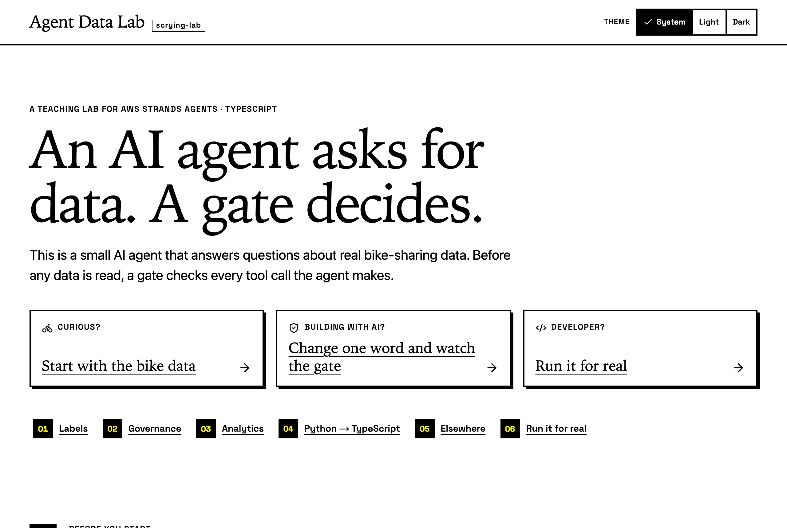
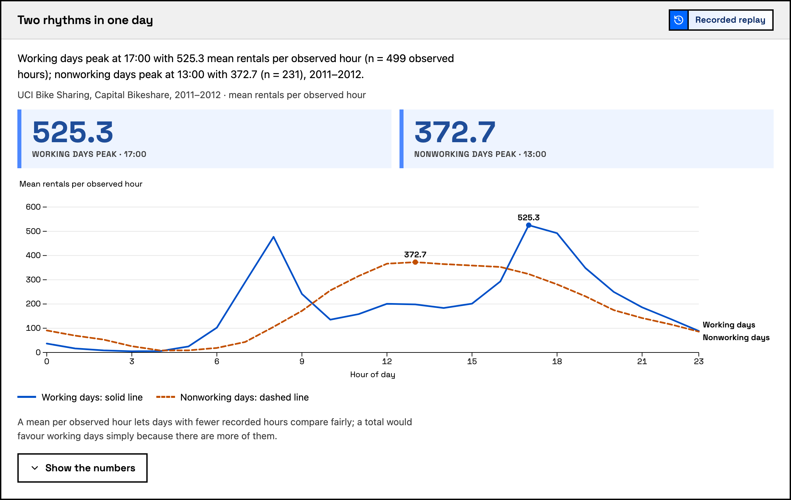
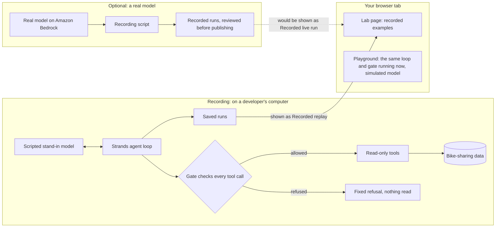

# Agent Data Lab

**A small AI agent that answers questions about real bike-sharing data, with a gate that checks every request before any data is read.**

[Try it](#try-it) · [How to use it](#how-to-use-the-lab) · [How it works](#how-it-works) · [Run it yourself](#run-it-yourself) · [Releases](#releases)

> [!NOTE]
> Everything on the lab page runs in your browser, and **no AI model is called there**: no keys, no sign-in, nothing leaves the page.
> The playground runs the real Strands agent loop and its gate right now, with a script playing the model's part. The other examples are recorded runs of the same code. <!-- claim: C-SIM-BROWSER-LOOP -->
> Runs made with a real AI model are recorded separately and always labelled as recordings.

---

## What is this?

An **AI agent** is a program in which a language model decides which tool to use next. Here, the tools can only *read* one thing: hourly bike rentals from Capital Bikeshare in Washington, DC.
The file holds 17,379 observed hours across 2011 and 2012. <!-- claim: C-DATA-ROWS -->

You change one word in a small block, such as *who is asking*, press Run, and watch the agent's request go through the gate. Or you pick a question about the bike data and follow a recorded run. The agent asks for a tool. Before the tool runs, a **gate** checks the request. If the gate agrees, the tool reads the data and you see a chart. If it refuses, nothing is read, and the lab shows you why.

The code is small on purpose. The lab is really about the **infrastructure around an agent**:

- who is allowed to read what, and how that is enforced;
- how to prove a refusal read nothing, rather than trusting what the model says;
- how to label every result honestly, so a recording is never passed off as a live run;
- how to test, evaluate and host an agent safely in public.

A second lesson uses **invented data** for a fictional operator, Northgate Cycle Co-op, to show role-based permissions. It is always labelled synthetic and is never mixed with the real measurements.

## Who is this for

| If you are… | Start here | Then |
|---|---|---|
| **Curious, with no coding background** (a recruiter, a reader, a colleague) | [Try it](#try-it). You do not need to install anything. | [How to use the lab](#how-to-use-the-lab) and [What you'll learn](#what-youll-learn) |
| **An engineer** interested in agent infrastructure | [How it works](#how-it-works) | The [traceability table](docs/traceability.md), the [run contract](agent/run-contract.ts) and the [gate](governance/policy.ts) |
| **A developer, or an AI agent working in this repository** | [Run it yourself](#run-it-yourself) | The [agent handbook](AGENTS.md), the [changelog](CHANGELOG.md) and the [release pattern](docs/releasing.md) |

## Try it

**[Open the lab][try-it]** — it works in any modern browser, phones included. Nothing to install, no sign-in.



## How to use the lab

**What you can do on the page**

1. **Change one word and run it.** In *Who gets to read what?*, edit who is asking or what the simulated model asks for, then press **Run**. Each "Try" button changes exactly one word and tells you what the gate should do.
2. **Read the result.** It says *Allowed* or *Refused*. A refusal names the check that stopped it, shows the exact sentence the model was told, and confirms that nothing was read.
3. **Follow the run step by step.** The **Guide** comes first and narrates each step in plain words (**Next**, **Back**, or **Play**). Developers can open **Every step with timings** for the step list and a graph of the same steps.
4. **Try the recorded examples**, including a forged permission and a document that tries to trick the agent.
5. **Explore the bike data.** Pick a question, allow or block the data read, and open **Show the numbers** under a chart to see the exact table.


**What the three labels mean**

The lab sorts every result into exactly one of these three kinds, so you always know how it was produced.

| Label | What happened | Did a real AI model run? | Where you see it today |
|---|---|---|---|
| **Recorded replay** | A run saved earlier with a scripted stand-in for the model, played back step by step. | No | The recorded examples on the lab page. |
| **Simulated in your browser** | The real Strands agent loop runs now, in your browser tab. A script plays the model's part. Nothing leaves the page. | No | The playground on the lab page, every time you press Run. |
| **Recorded live run** · Amazon Bedrock · model · region · date | A real model on Amazon Bedrock ran this earlier, and the run was saved and reviewed. You are watching the recording, not a live call. | Yes, at the recorded date | Not yet: no live recording has been published. |

> [!TIP]
> A refusal is the system working as designed, not an error. When the gate says no, the lab shows that **no data was read**.

## What you'll learn

- **What an agent loop is.** The model asks for a tool, the tool runs, and the model writes an answer from the result ([`agent/run.ts`](agent/run.ts)).
- **How a gate works.** Every tool call is checked in a fixed order: allowed tool → correct shape → known caller → permitted arguments → read budget ([`governance/policy.ts`](governance/policy.ts)).
- **Why identity comes from the app, not the model.** A request cannot raise its own permissions by claiming a role.
- **How to prove a refusal.** A ledger records every protected read. A refusal must leave it empty.
- **Why the model sees fixed sentences.** Raw errors, file paths and validation messages never reach the model ([`agent/run-contract.ts`](agent/run-contract.ts)).
- **How to label evidence honestly.** Replay, simulated and live results are kept apart, and every public number is tied to a test ([`content/claims/`](content/claims/)).
- **How to read a chart with care.** Sample sizes matter: heavy rain or snow appears in only 3 observed hours. <!-- claim: C-DATA-HEAVY-WEATHER -->
- **How to keep a public project safe.** No stored keys, short-lived sign-in, a strict Content-Security-Policy, a bundle check and a public-safety scan.



## How it works



**The same diagram in words.** On a developer's computer, the Strands agent loop runs with a scripted stand-in playing the model. The stand-in asks for a tool, and the loop passes every tool request to the gate. If the gate allows it, a read-only tool reads the data. If the gate refuses, the loop receives a fixed refusal sentence and no data is read. Each run is saved. In your browser tab, the lab page shows those saved runs, labelled "Recorded replay". The playground on the same page runs that same agent loop and gate right now, inside the tab, with a simulated model playing the model's part, labelled "Simulated in your browser"; nothing leaves the page. Optionally, a recording script can run the agent against a real model on Amazon Bedrock. Those runs would be saved, reviewed, and only then shown on the page, labelled "Recorded live run"; none has been published yet. The page itself never calls a real model.

<details>
<summary><strong>For engineers: where each part lives</strong></summary>

| Part | Where |
|---|---|
| Run contract shared by engine, fixtures, evaluation and views (`lab-run/v1`) | [`agent/run-contract.ts`](agent/run-contract.ts) |
| Gate: allowlist → schema → caller → arguments → budget | [`governance/policy.ts`](governance/policy.ts) |
| Governance tool contracts and synthetic data | [`governance/contracts.ts`](governance/contracts.ts), [`governance/synthetic.ts`](governance/synthetic.ts) |
| Analytics measurements (Arquero) and the lesson's small gate | [`analytics/compute.ts`](analytics/compute.ts), [`analytics/gate.ts`](analytics/gate.ts) |
| Strands agent with a permission hook (analytics lesson) | [`agent/run.ts`](agent/run.ts) |
| Governed runner: the gate before every tool call, simulated model, cancellation | [`agent/governed-run.ts`](agent/governed-run.ts), [`agent/playground-model.ts`](agent/playground-model.ts) |
| Playground: editable blocks parsed as data, never run as code | [`src/playground/`](src/playground/), [`content/block-hints.ts`](content/block-hints.ts) |
| Trace, graph and the narrating guide | [`src/trace/`](src/trace/), [`content/narration.ts`](content/narration.ts) |
| Charts with tables and honest sample sizes | [`src/charts/`](src/charts/) |
| Evaluation: 20 cases plus 3 regressions, stored results | [`evaluation/`](evaluation/) (`npm run eval`) |
| Browser harness proving the loop runs in a page | [`src/harness.ts`](src/harness.ts), [`tests/e2e/harness.spec.ts`](tests/e2e/harness.spec.ts) |
| Live recording (Amazon Bedrock), refusing long-lived keys | [`agent/bedrock.ts`](agent/bedrock.ts), [`agent/credentials-guard.ts`](agent/credentials-guard.ts) |
| Browser build guards and Content-Security-Policy | [`vite.config.ts`](vite.config.ts), [`scripts/bundle-check.mjs`](scripts/bundle-check.mjs) |
| Public numbers and their evidence | [`content/claims.ts`](content/claims.ts) |
| Requirement → code → evidence | [`docs/traceability.md`](docs/traceability.md) |

The WSO2 AI gateway setup in [`infra/wso2/`](infra/wso2/) is an experiment and has not been verified end to end.

</details>

## Run it yourself

You need [Node.js][node] 24 (the version in [`.nvmrc`](.nvmrc)). No cloud account is needed for any of this.

```sh
git clone https://github.com/scrying-lab/agent-data-lab.git
cd agent-data-lab
npm ci           # install the exact dependency versions
npm test         # run the unit tests
npm run dev      # start the lab at the address it prints
npm run check    # the full gate: types, lint, tests, build, safety scan
```

| Command | What it does |
|---|---|
| `npm run e2e` | Opens the built site in real browsers (Playwright) and checks it end to end |
| `npm run record` | Regenerates the scripted recordings. No AI model and no network |
| `npm run build` | Builds the site into `dist/` and checks the bundle for anything that must not ship |

<details>
<summary><strong>Optional: record a run with a real model on Amazon Bedrock</strong></summary>

This uses **your own AWS account** and may cost money. The project never stores keys.

1. Sign in with a short-lived session: `aws sso login --profile your-profile`
2. Run the recorder with that profile. Region, model IDs and limits come from [`lab.config.ts`](lab.config.ts) (none of them is a secret):

   ```sh
   AWS_PROFILE=your-profile npm run record:bedrock -- hourly --model novaMicro
   ```

   Use `--model claudeHaiku` for the other configured model. Each run is capped at 3 turns, 320 output tokens per turn and one data read.

The recorder refuses Bedrock API keys and long-lived access keys. [`.env.example`](.env.example) lists variable **names only**; never put a value in it and never commit a `.env` file. Recordings are written to a git-ignored folder so you can review them before sharing anything. A successful live recording has not yet been verified.

</details>

## Purpose

<!-- Written by the project owner. Agents and contributors: leave the prompts below as they are. -->

### Why governance before features

[Why governance before features]

### What learning in public means here

[What learning in public means here]

### Where to read more

[Where to read more — link to my website]

## Releases

Version **1.0.0** is the first release. Every change after it ships as a numbered release with notes.

- [CHANGELOG.md](CHANGELOG.md): what changed in each version, in plain words.
- [docs/releasing.md](docs/releasing.md): how a release is checked and published.

## Credits and licences

- **Data.** Hadi Fanaee-T, *Bike Sharing* (2013), UCI Machine Learning Repository, [doi:10.24432/C5W894][dataset], licensed [CC BY 4.0][cc-by]. The included `hour.csv` is unmodified; the lab computes its own summaries from it.
- **Inspiration.** The AWS Houston User Group Strands Agents workshop ([event resources][houston]) and its [AWS sample notebooks][aws-workshop] (MIT-0). The WSO2 AI gateway session ([gateway release][wso2-release], [Bedrock provider guide][wso2-bedrock]).
- **Built on** the [Strands Agents TypeScript SDK][strands] (Apache-2.0) and other open-source libraries listed in [NOTICE](NOTICE).
- **Licences.** Code is [MIT](LICENSE). Written lessons and documentation are [CC BY 4.0](LICENSE-DOCS.md).
- **Built with AI assistance.** AI coding assistants helped write and review this project. Public numbers are tied to tests through the [claims registry](content/claims.ts), and every result says how it was produced.

More detail on sources and design choices: [docs/references.md](docs/references.md).

[try-it]: https://scrying-lab.github.io/agent-data-lab/
[dataset]: https://doi.org/10.24432/C5W894
[cc-by]: https://creativecommons.org/licenses/by/4.0/
[houston]: https://main.d2vu7hxgv1aq23.amplifyapp.com/
[aws-workshop]: https://github.com/aws-samples/sample-strands-agents-hands-on-workshop
[wso2-release]: https://github.com/wso2/api-platform/releases/tag/ai-gateway%2Fv1.2.0
[wso2-bedrock]: https://wso2.com/api-platform/docs/ai-gateway/next/gateway-artifacts/llm-provider/supported-providers/aws-bedrock/
[strands]: https://strandsagents.com/docs/user-guide/sdk/quickstart/typescript/
[node]: https://nodejs.org/
